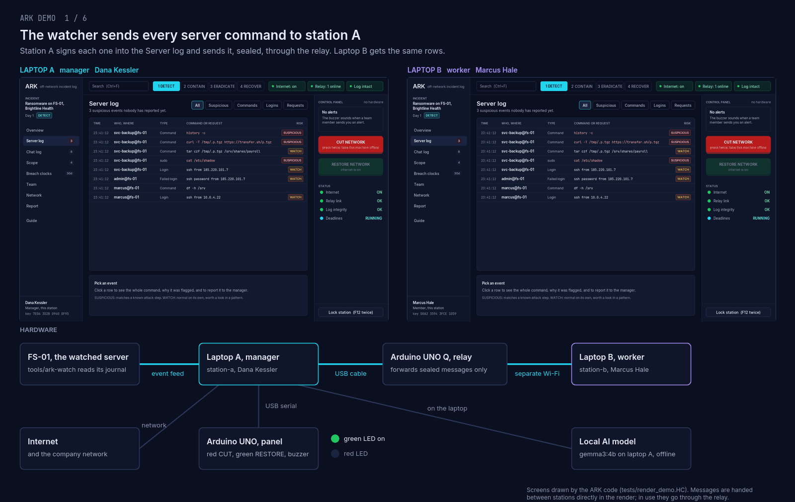

# Running the demo



The GIF is drawn from the real code: `tests/render_demo.HC` runs both stations through the story below and `tools/make-demo-gif.py` lays out the screens with the hardware. The one difference from a live run is that the render hands messages between stations directly instead of through the relay.

## Who is who

| Machine | Role | What runs on it |
|---|---|---|
| Laptop A | manager (Dana) | `station-a`, `tools/ark-watch`, the Arduino UNO panel on USB |
| Laptop B | worker / analyst (Marcus) | `station-b` |
| Arduino UNO Q | relay | `relay/hub.py` (forwards sealed messages), the ARK animation on its LED matrix |
| Arduino UNO | panel, plugged into laptop A | `firmware/panel`: red CUT, green RESTORE, two LEDs, buzzer |
| FS-01 | the watched server | in the demo, laptop A plays it: the shell hook and `tools/ark-watch` |

Laptop A reaches the relay over USB. Laptop B reaches it over a Wi-Fi network the team controls (the UNO Q joins it), never the company network. For a one-laptop rehearsal both stations run on laptop A and both use USB.

## One-time setup

Everything below runs from the repo root.

```sh
# Build and test
hcc src/main.HC -o build/ark
./tests/run.sh

# Flash the panel (close the Arduino IDE first; its serial monitor holds the port)
arduino-cli compile --fqbn arduino:avr:uno firmware/panel
arduino-cli upload --fqbn arduino:avr:uno -p /dev/ttyUSB0 firmware/panel

# Copy the relay hub to the UNO Q
adb devices                                   # the UNO Q shows as a serial number
adb shell mkdir -p /home/arduino/ark
adb push relay/hub.py /home/arduino/ark/hub.py
```

The LED matrix animation is set up once as described in [firmware/relay-matrix/README.md](../firmware/relay-matrix/README.md); it starts by itself at every boot.

## Clean slate before a demo

Close every ARK window, then:

```sh
rm -rf station-a station-b                    # identities, keys, logs, feeds
rm -rf build/tmp-*                            # test and render leftovers
```

This deletes the incident and both identities for good. Each station asks for a new name and passphrase on its next start.

## Start the relay

```sh
adb shell 'pgrep -f "^python3 hub.py" >/dev/null || (cd /home/arduino/ark && setsid nohup python3 hub.py > hub.log 2>&1 < /dev/null &)'
adb shell 'ss -ltn | grep 4210'               # should print a LISTEN line
```

The hub doesn't start at boot. Run this again after the UNO Q restarts or loses power.

## Two stations on one laptop

Each command in its own terminal:

```sh
PANEL=/dev/ttyUSB0 ./station.sh station-a usb      # terminal 1: manager, with the panel
./station.sh station-b usb                         # terminal 2: worker
```

## Two laptops

Laptop A, with the UNO Q and the panel on USB:

```sh
PANEL=/dev/ttyUSB0 ./station.sh station-a usb
```

Join the UNO Q to the team's Wi-Fi once, and find its address:

```sh
adb shell nmcli dev wifi connect SSID password PASSWORD
adb shell ip -4 addr show wlan0               # the inet address, e.g. 10.147.184.235
```

Laptop B, on the same Wi-Fi, with this repo cloned and built:

```sh
hcc src/main.HC -o build/ark
./station.sh station-b wifi 10.147.184.235
```

Don't press red on laptop B: its link to the relay is Wi-Fi, so cutting its network cuts it off the team too.

## First start: incident and join

1. **Station A:** name, passphrase twice, **Start an incident**, title (e.g. `Ransomware on FS-01`).
2. **Station B:** name, passphrase twice, **Join an incident**. It shows a 6-digit code.
3. Station A's panel beeps once. On A's Team page (or F9), check the code matches what B shows, and approve.

B now has the team key and the whole log.

## Feeding the Server log

On laptop A, in one terminal:

```sh
tools/ark-watch station-a
```

In another, either be the intruder by hand in a shell with the hook loaded:

```sh
source tools/hooks/ark-shell.zsh              # or .bash / .fish
cat /etc/shadow                               # fails without sudo, still logged
```

or run the rehearsal, which logs attacker-style commands without running them:

```sh
tools/drill.sh                                # DRILL_GAP=5 tools/drill.sh for slower steps
```

sudo commands, SSH and su logins and failed passwords are picked up from the journal without the hook. Add `--access-log /var/log/nginx/access.log` to `ark-watch` for web requests.

## The story, step by step

1. **Run the drill.** Rows appear on both stations' Server log. SUSPICIOUS ones are red; the sidebar counts the ones nobody has reported.
2. **On B,** filter to Suspicious and click `cat /etc/shadow`. The panel underneath shows who ran it, where, and why it was flagged.
3. **On B,** press **Report to manager**. A's panel beeps three times and the alert sits at the top of A's control panel. B shows the row as REPORTED.
4. **On A,** press **Acknowledge**, then the red button. The red LED lights, the top bar reads **Internet: CUT**, and a signed entry tells everyone. Chat between A and B keeps working.
5. **On A,** press green once "backups are done". The green LED lights and the internet comes back. Only the manager's station can do this.

### Rehearsing without losing the internet

The red button runs `nmcli networking off` for real. To rehearse, give the station stand-in commands:

```sh
ARK_CUT_CMD=true ARK_RESTORE_CMD=true PANEL=/dev/ttyUSB0 ./station.sh station-a usb
```

Everything looks and logs the same, but the network stays up. Drop the two variables for the real thing. If `nmcli` asks for a password when run from the station, the logged-in user lacks NetworkManager rights; run the demo from a desktop session of a user in `wheel`.

## Troubleshooting

| Symptom | Fix |
|---|---|
| `stty: /dev/ttyUSB0: Device or resource busy` | The Arduino IDE (its serial monitor) has the port. Quit the IDE fully, then start station A again. |
| `could not reach the relay at TCP:127.0.0.1:4210` | UNO Q not on USB, or the hub isn't running. Check `adb devices`, then start the relay. |
| Top bar says **Relay: alone** | The other station isn't connected yet, or the hub restarted. Restart that station. |
| A station shows the unlock screen and the passphrase is lost | There's no recovery. Close it, `rm -rf station-a` (or `-b`), start over. |
| Server log stays empty | `ark-watch` must point at the station directory of a running, unlocked station (`station-a`). Commands typed in a shell show only with the hook sourced in that shell. |
| Panel doesn't beep or light | Reflash `firmware/panel`. Station A must be started with `PANEL=/dev/ttyUSB0`. |

## Remaking the GIF

```sh
hcc tests/render_demo.HC -o build/render_demo
SDL_VIDEODRIVER=offscreen ./build/render_demo
python3 tools/make-demo-gif.py                # writes docs/demo.gif
```

## Shutting down

Close both windows (each wipes its keys from memory), stop `ark-watch` with Ctrl+C, then:

```sh
adb shell 'pkill -f "^python3 hub.py"'
```
